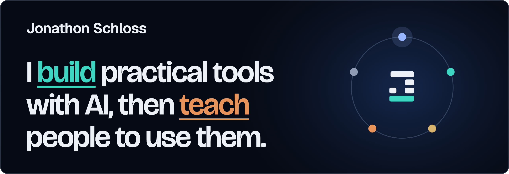

**Systems over hustle. Leverage over hours.**

I came to AI from the business side of the trades, and I still start in the same place: find where the work gets stuck, decide how we'll know it worked, then build the smallest thing that fixes it. Tools draft and check. A person says yes before anything changes.

Most of what I build runs on private systems, so it isn't here. This is the work I can show.

## Shipped

**[jonathonschloss.com](https://jonathonschloss.com)** 
My site and learning log. Includes a filterable map of what I do and a scroll-through timeline of how the work grew.

**[Your first AI shortcut, in five steps](https://jonathonschloss.com/log/your-first-ai-shortcut-in-five-steps/)** 
A beginner checklist for testing whether AI can take the boring part of one task.

**[AI shouldn't hit "send" on its own](https://jonathonschloss.com/log/ai-shouldnt-hit-send-on-its-own/)** 
Why every tool I build that changes something does a dry run, shows the exact change, and waits for approval.

## Experiments

These are me learning in public. They are not products.

**[How one GPU serves many chats at once](https://jonathonschloss.com/log/how-one-gpu-serves-many-chats/)** 
A part-by-part teardown of PagedAttention, the memory trick behind vLLM, with a short script you can run to see the idea yourself.

**[What I'm watching next](https://jonathonschloss.com/log/what-im-watching-next/)** 
What I'm still figuring out, starting with running smaller models on hardware you control. Lots of reading, lots of breaking things.

## Find me

[Website](https://jonathonschloss.com) · [Learning log](https://jonathonschloss.com/#log) · [LinkedIn](https://www.linkedin.com/in/jonathonschloss/) · [X](https://x.com/JonathonSchloss)

