<a href="https://jonathonschloss.com"></a>

<b>Systems over hustle. Leverage over hours.</b>

I came to AI from the business side of the trades, and I still start in the same place: find where the work gets stuck, decide how we'll know it worked, then build the smallest thing that fixes it. **Tools draft and check. A person says yes before anything changes.**

Most of what I build runs on private systems, so it isn't here. This is the work I can show, plus a peek at what's on the bench.


  
  

  
  


  
  

Built at night, kept private on purpose. When there's something worth showing, it'll show up here first.


  <a href="https://jonathonschloss.com"></a>
  <a href="https://jonathonschloss.com/log/your-first-ai-shortcut-in-five-steps/"></a>

  <a href="https://jonathonschloss.com/log/ai-shouldnt-hit-send-on-its-own/"></a>

Me learning in public. These are not products.

  <a href="https://jonathonschloss.com/log/how-one-gpu-serves-many-chats/"></a>
  <a href="https://jonathonschloss.com/log/what-im-watching-next/"></a>

  
  
  
  

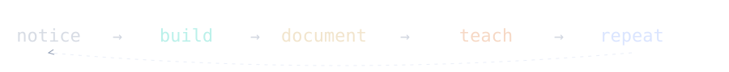
